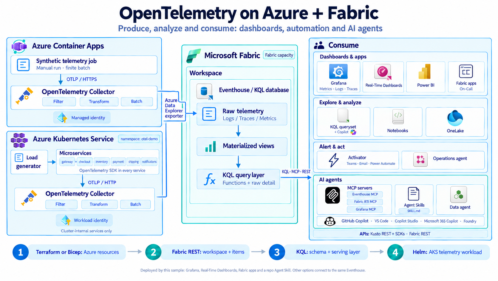

# OpenTelemetry on Azure + Fabric: Logs, Traces, Metrics, and On-Call

[](#quick-start-azure-recommended)
[](#local-development)
[](#capabilities)

This sample collects **OpenTelemetry logs, traces, and metrics** in Microsoft
Fabric Eventhouse and turns them into correlated investigations, dashboards,
and optional observability and on-call apps.

It combines managed-identity ingestion, minute-level KQL aggregation, Azure
Managed Grafana, and native Fabric Real-Time Dashboards. A bounded synthetic
Container Apps job demonstrates the complete flow without an existing
application; an optional AKS workload keeps telemetry flowing continuously.

## Capabilities

The sample provides several delivery surfaces over one telemetry store:

| Surface | Tech | Primary Use | Output |
| --- | --- | --- | --- |
| **Grafana dashboards** | Azure Managed Grafana + KQL | Operational exploration | Metrics, Logs, Traces, Issues, Releases, and Agents dashboards with a trace waterfall and service map |
| **Fabric dashboards** | Fabric Real-Time Dashboards | Native workspace visualization | Six matching dashboards with linked filters, trace and agent-run investigation |
| **Observability apps (optional)** | Rayfin + React + TypeScript | Compare familiar observability workflows | Unofficial Datadog, Coralogix, and groundcover mock apps |
| **RTI On-Call app (optional)** | Rayfin + Fabric Functions + Activator | Compare on-call designs and author alerts | Simulated pages/schedules plus persistent, live Teams/email alert rules |
| **AI agents (optional)** | Eventhouse/Grafana MCP + Agent Skills | Natural-language investigation | Queries and correlated evidence from the same telemetry |

Core functionality includes:

- **Three-signal OTLP ingestion** through OpenTelemetry Collector Contrib, with
  managed identity on Container Apps and workload identity on optional AKS.
- **Correlated logs and traces** using run, trace, and span IDs, without
  high-cardinality identifiers in metric dimensions.
- **Minute-level materialized views** and reusable KQL serving functions.
- **Error tracking:** failed spans grouped into issues by fingerprint, with
  triage state and `new_issue`, `regression`, and `unmute` alerts through
  Activator ([guide](docs/issues-and-alerts.md)).
- **Release health** per `service.version`, comparing each release with the
  previous one ([guide](docs/release-health.md)).
- **AI agent tracing** from OpenTelemetry GenAI spans: runs, handoffs, tokens by
  model, and tools ([guide](docs/ai-agents.md)).
- **Investigation toolbox:** task-shaped KQL functions that AI agents call through
  an Eventhouse MCP server, plus telemetry volume and coverage.
- **Repeatable Azure setup** with Bicep or Terraform, followed by Fabric REST
  bootstrap and a separate database ingestor grant.
- **Two workload modes:** a finite job with four synthetic service contexts, or
  six instrumented AKS microservices plus a synthetic AI assistant with
  continuous traffic and an on-disk collector queue.

---

## Prerequisites

Prepare only the tools and access needed for your chosen path.

### Required Tooling

| Path | Tooling |
| --- | --- |
| Azure demonstration | Current Azure CLI, Python 3.10+, and either Bicep through `az bicep` or Terraform |
| Local collector debug | Python 3.10+, Docker, and Docker Compose |
| Optional AKS workload | Terraform, Azure CLI, `kubectl`, `kubelogin`, and Helm |
| Optional Fabric apps | Node.js 24+, npm, Azure CLI, and Rayfin CLI through `npx` |

The Python bootstrap and finite producer use the standard library. The Azure
demonstration does **not** require Docker, Node.js, Kubernetes, or an image build.
CI pins its infrastructure tool versions in
[the validation workflow](.github/workflows/validate.yml).

### Azure and Fabric Access

- An Azure subscription with permission to create resources and required role
  assignments in a dedicated demo resource group.
- A Fabric tenant with an eligible active capacity or trial, workspace-creation
  permission, and permission to assign that capacity.
- A Fabric database administrator to grant the collector **ingestor** access.
  Azure resource permissions alone do not grant Fabric data access.
- For Grafana, an operator assigned Grafana access and its managed identity
  granted **Viewer on the dedicated Fabric workspace**.

Sign in before running live setup or query commands:

```shell
az login --tenant <tenant-id>
az account set --subscription <subscription-id>
az account show
```

See the deployment guides for provider registration, regional availability, and
service-principal tenant settings. Local debug and offline checks need no Azure
login.

### Configuration

Keep deployment-specific values in git-ignored private files:
`infra/main.local.bicepparam` for Bicep or
`infra/terraform/devenv.local.tfvars` for Terraform.
The bootstrap result belongs in `output/fabric.local.json`.

The optional apps read that result or these environment variables:

```shell
export KUSTO_CLUSTER_URI='https://<query-service-host>.kusto.fabric.microsoft.com'
export KUSTO_DATABASE='Observability'
```

Use the **query service URI**, not the ingestion URI. The cloud collectors use
managed identities, not client secrets. Do not commit credentials, deployment
output, or customer telemetry.

---

## Quick Start: Azure (recommended)

The baseline is a staged deployment, not a one-command installer. Billable
resource switches are **off by default**; review cost and enable them deliberately.
Use one IaC owner per Azure resource.

### 1. Provision the foundation and bootstrap Fabric

Choose the [Bicep deployment guide](docs/deployment.md) or
[Terraform deployment guide](docs/terraform-deployment.md). Follow its order:

1. Create the collector identity and optionally Managed Grafana or a new capacity.
2. Bootstrap the dedicated Fabric workspace, Eventhouse, and KQL database.
3. Grant the collector identity database ingestor access.
4. Enable the cloud collector and bounded synthetic job.

> **Important:** A Fabric capacity UUID is not its Azure ARM resource ID.
> Collector client IDs and Grafana principal object IDs are also different
> identifiers. The guides show which value belongs in each step.

### 2. Run the synthetic job

After the guide sets `RESOURCE_GROUP` and `DEMO_JOB_NAME`:

```shell
az containerapp job start \
  --name "$DEMO_JOB_NAME" --resource-group "$RESOURCE_GROUP"
az containerapp job execution list \
  --name "$DEMO_JOB_NAME" --resource-group "$RESOURCE_GROUP" -o table
```

The manual job sends 60 requests, simulates an error every fifth request, and
exits. An isolated successful run produces **240 spans, 60 logs, and 120 metric
points**, with **60 root requests and 12 root errors**.
Collector acknowledgement is not proof of Fabric ingestion; verify rows using
[`fabric/queries.kql`](fabric/queries.kql) and save the run ID for correlation.

### 3. Open the dashboards

Configure the Grafana managed-identity data source and import the six dashboards
in [`grafana/`](grafana/) ([`metrics.json`](grafana/metrics.json),
[`logs.json`](grafana/logs.json), [`traces.json`](grafana/traces.json),
[`issues.json`](grafana/issues.json), [`releases.json`](grafana/releases.json),
and [`agents.json`](grafana/agents.json)) using the Grafana import screen.
Optionally publish the six native Fabric dashboards with
[`scripts/deploy-fabric-dashboard.py`](scripts/deploy-fabric-dashboard.py), as
described in the deployment guide.

Use the [guided demonstration](docs/demo-guide.md) to explore a healthy request,
a simulated error, the rollups, and a correlated trace.

### 4. Add continuous traffic or apps (optional)

The [AKS workload demo](docs/aks-demo.md) is Terraform-only and opt-in. It adds
six services, a load generator, and an in-cluster collector to keep dashboards
live. AKS records use environment `aks`; the finite job uses `demo`.

The [Fabric apps guide](docs/mock-apps.md) covers all four Rayfin apps. Local
visualizations query live telemetry; deployed visualizations use a point-in-time
snapshot. RTI On-Call's authenticated alert backend separately creates live
Activator rules. Its current backend expects a KQL database named
`observability` in the app's workspace; follow the app-specific setup guidance
rather than assuming the baseline `Observability` name works unchanged.

---

## Local Development

### 1. Inspect payloads without cloud access

From the repository root:

```shell
python3 demo/emit.py --dry-run
```

This prints one request's log, trace, and metric payloads without sending them.

### 2. Run the local collector with Docker

```shell
docker compose -f collector/compose.yaml up -d
curl --fail http://127.0.0.1:13133/
python3 demo/emit.py --endpoint http://127.0.0.1:4318 --count 12 --interval 0.2
docker compose -f collector/compose.yaml logs collector
docker compose -f collector/compose.yaml down
```

Ports are published on loopback only. This collector filters and transforms
synthetic telemetry and writes it to a **debug exporter**, not Fabric. The Azure
collector's internal endpoint cannot be called directly from a laptop.

### 3. Run the optional apps

With readable telemetry in Fabric and Azure CLI signed in:

```shell
cd apps
npm ci --ignore-scripts
npm ci --ignore-scripts --prefix rti-oncall/packages/functions
npm run api
```

In a separate terminal, from `apps/`, start one frontend:

```shell
npm run dev:datadog       # http://localhost:5181
# Alternatives:
npm run dev:coralogix     # http://localhost:5182
npm run dev:groundcover   # http://localhost:5183
npm run dev:rti-oncall    # http://localhost:5184
```

The read-only API listens on `127.0.0.1:8787`; frontends refresh every 15 seconds
and fall back to their bundled snapshot when the API is unavailable.
Deployment, Fabric SSO, and live alert authoring require the additional steps in
the [apps guide](docs/mock-apps.md).

---

## API Endpoints

The optional apps' local telemetry API is read-only and uses the operator's Azure
CLI sign-in. It is not a public or deployed Fabric API.

| Method | Endpoint | Description |
| --- | --- | --- |
| `GET` | `/api/health` | Local API health and configured database |
| `GET` | `/api/telemetry?minutes=60` | Services, dependencies, traces, logs, metrics, and on-call history |

Fabric workspace/item management uses the Fabric REST API through the bootstrap
scripts. RTI On-Call's `alertRules` function is a separate authenticated Fabric
Functions backend, not an endpoint on this local API.

---

## Telemetry Model

| Layer | Assets | Purpose |
| --- | --- | --- |
| Raw records | `OTELLogs`, `OTELTraces`, `OTELMetrics` | Detailed investigation, correlation, and metric samples; seven-day raw retention |
| Minute rollups | `Logs1m`, `Requests1m`, `Metrics1m` | Incrementally maintained log counts, root-request health, and metric summaries |
| Serving functions | `LogsOverview`, `RequestsOverview`, `MetricDurationOverview` | Time-bounded query contracts for consumers |

Only root spans count as requests; child spans do not inflate request totals.
Run IDs are kept in trace/log detail, not metric dimensions or rollups.
The demo emits `demo.requests` and `demo.request.duration`; the duration serving
function summarizes gauge samples, not request rate.

See [KQL and materialized views](docs/kql-and-materialized-views.md) for schema,
aggregation semantics, and retention policies.

---

## Technical Architecture Overview

The solution separates telemetry collection, storage, aggregation, and
consumption so each can evolve independently.



### Main Components

- **Producers (`demo/`, `k8s/`)**: finite synthetic job or optional continuously
  instrumented AKS services.
- **Collectors (`collector/`, `k8s/otel-demo/`)**: OTLP receivers, demo-contract
  filtering, attribute transformation, batching, and Eventhouse export.
- **Azure infrastructure (`infra/`)**: identities, optional capacity, Grafana,
  collector/job hosting, platform diagnostics, and Terraform-only AKS.
- **Fabric bootstrap (`scripts/`)**: workspace, Eventhouse, database/schema,
  Grafana Viewer grant, and optional native dashboard publishing.
- **Analytics (`fabric/`)**: raw tables, materialized views, serving functions,
  and investigation queries.
- **Consumers (`grafana/`, `apps/`, `.github/skills/`)**: dashboards, optional
  observability/on-call apps, and schema-aware agent investigation.

### Why this design?

- Keeps **Azure provisioning**, **Fabric item management**, and **Kusto
  permissions/schema** separate and explicit.
- Reuses **one telemetry contract** across dashboards, apps, and AI agents.
- Demonstrates **secretless collector authentication** and bounded generation
  without requiring an application or cluster.
- Keeps continuous traffic, alerting, and additional consumers opt-in.

This is a reference sample, not a production observability platform. Internal
Container Apps ingress is not end-to-end private networking; export queues are
in-memory, and retries can duplicate records. The baseline creates no alert
rules. Optional RTI On-Call alert authoring can create real Activator Teams/email
actions, while its schedules, paging, and escalation workflows remain simulated.
Power BI, notebooks, OneLake, the data agent, and other consumers require
additional configuration.

See [architecture](docs/architecture.md),
[consumer options](docs/consume.md), and
[security and operations](docs/security-and-operations.md).
The [buffered ingestion option](docs/buffered-architecture.md) includes an
Event Hubs foundation, not a complete Eventstream ingestion pipeline.
Generated illustrations are explanatory; the IaC, collector configuration, KQL,
and [editable diagrams](docs/diagrams/) define the technical contract.

---

## Project Structure

```text
fabric-rti-monitoring/
├── infra/
│   ├── main.bicep
│   ├── terraform/
│   ├── terraform-state/
│   └── optional/
├── collector/
├── demo/emit.py
├── k8s/otel-demo/
├── fabric/
│   ├── schema.kql
│   ├── queries.kql
│   └── dashboards/
├── grafana/
├── apps/
│   ├── telemetry/
│   ├── oncall/
│   ├── datadog-mock/
│   ├── coralogix-mock/
│   ├── groundcover-mock/
│   └── rti-oncall/
├── scripts/
├── tests/
├── .github/skills/
└── docs/
```

---

## Development Workflow

### Run tests and documentation checks

```shell
python3 -m unittest discover -s tests -v
python3 scripts/validate_repository.py
```

For the optional apps, after installing their dependencies:

```shell
cd apps
npm test
npm run typecheck
npm run build
```

### Infrastructure and collector checks

CI compiles Bicep, validates and tests mocked Terraform plans for both roots,
lints/renders the AKS Helm chart, validates all three collector configurations,
and runs collector smoke tests. For local commands and the separate **cloud
acceptance checklist**, see [validation](docs/validation.md).

Passing offline checks does not prove tenant permissions, service availability,
managed-identity ingestion, or dashboard rendering in your deployment.

---

## Troubleshooting

### Authentication or permission errors

```shell
az account show
az login --tenant <tenant-id>
az account set --subscription <subscription-id>
```

Check Azure RBAC and Fabric permissions separately. Verify the collector's
**client ID** is the database ingestor and Grafana's **principal object ID** is
the workspace Viewer. A broader Azure role does not fix missing Fabric access.

### No telemetry or empty dashboards

- Confirm the manual job completed or the optional AKS pods are running.
- Check collector console logs, capacity state, query URI, and database name.
- Query raw tables before diagnosing rollups; allow for ingestion delay.
- Select a time range containing the run and the correct environment/service.
- Import Grafana dashboards through the UI so `DS_FABRIC` is resolved.

### Local Docker startup issues

```shell
docker compose -f collector/compose.yaml logs collector
curl --fail http://127.0.0.1:13133/
```

Check that ports 4317, 4318, and 13133 are available. Local debug records appear
in collector logs, not in Fabric.

### App snapshots or Fabric sign-in

Deployed visualizations do not continuously refresh: regenerate the snapshot
with `npm run snapshot -- 60` from `apps/`, rebuild, and redeploy with Rayfin.
Use the generated `hostingUrl`, allow the Fabric sign-in popup, and sign in with
workspace access. Starting live Activator rules can send real notifications;
save them stopped if you only want to demonstrate authoring.

For teardown, follow the deployment guide: Azure resources and Fabric items are
managed separately. Stop optional continuous workloads and remove unused
billable resources after the demonstration.

---

## Contributing

1. Describe the scenario in an issue or pull request.
2. Update the implementation, documentation, and focused tests together.
3. Run the relevant checks and distinguish local results from cloud acceptance.
4. Open a pull request without credentials, tenant exports, or customer telemetry.

See [CONTRIBUTING.md](CONTRIBUTING.md), [SECURITY.md](SECURITY.md), and
[extending the sample](docs/extending.md).

## References

- [OpenTelemetry exporter for Fabric Eventhouse](https://learn.microsoft.com/en-us/azure/data-explorer/open-telemetry-connector)
- [Azure Managed Grafana managed-identity data sources](https://learn.microsoft.com/en-us/azure/managed-grafana/how-to-data-source-plugins-managed-identity)
- [Architecture asset sources and notices](docs/assets/README.md)

## License

Sample code is [MIT licensed](LICENSE). Third-party software and product assets
retain their respective licenses and usage terms in
[THIRD_PARTY_NOTICES.md](THIRD_PARTY_NOTICES.md). The optional vendor-style apps
are unofficial original demo mocks, not affiliated with or endorsed by those
vendors.
