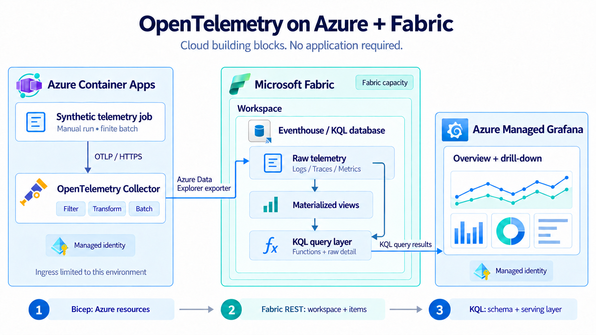

# OpenTelemetry on Azure + Fabric

Cloud building blocks for collecting logs, traces, and metrics with OpenTelemetry,
analyzing them in Microsoft Fabric Eventhouse, and exploring them in Azure Managed
Grafana. A bounded synthetic telemetry job makes the flow demonstrable before an
application exists.

## What you can demonstrate

| Capability | What the sample shows |
| --- | --- |
| Open instrumentation | OTLP/HTTP logs, spans, and gauge measurements from a small synthetic producer. |
| Managed ingestion | A collector on Azure Container Apps uses managed identity to write to a Fabric KQL database. |
| Correlated investigation | A log and its span share a trace ID; metrics use bounded dimensions. |
| Incremental aggregation | Three materialized views maintain minute-level log, request, and metric summaries. |
| Reusable query contracts | KQL functions serve the overview; raw tables support detailed investigation. |
| Visualization | A Grafana dashboard brings summaries, logs, and trace details into one view. |
| Repeatable setup | Bicep defines Azure resources; a separate Fabric REST bootstrap creates analytics items and applies KQL. |

## Start in Azure

Follow the [deployment guide](docs/deployment.md) to provision the foundation,
bootstrap Fabric, start the collector, and run the synthetic job. Resource switches
are off by default so creating billable services is an explicit choice. No local
Docker runtime, application deployment, Kubernetes cluster, or custom image build
is required for the Azure demonstration.

Then use the [guided demonstration](docs/demo-guide.md) to walk through a healthy
signal, a simulated error, the materialized summaries, and a correlated trace.

## Understand the design

- [Architecture and data flow](docs/architecture.md) - component boundaries,
  identity, and the three deployment surfaces.
- [KQL and materialized views](docs/kql-and-materialized-views.md) - raw tables,
  aggregation semantics, retention, and serving functions.
- [Security and operations](docs/security-and-operations.md) - sample boundaries,
  access, failure modes, and cost controls.
- [Validation](docs/validation.md) - automated checks and a separate cloud
  acceptance checklist.
- [Extending the sample](docs/extending.md) - how to introduce your own workloads
  and decide which additional capabilities to add.

## Repository map

| Path | Contents |
| --- | --- |
| [`infra/`](infra/) | Bicep foundation and collector/job hosting. |
| [`scripts/bootstrap-fabric.py`](scripts/bootstrap-fabric.py) | Fabric workspace, Eventhouse, and KQL database setup. |
| [`collector/`](collector/) | Cloud collector configuration and optional developer configurations. |
| [`demo/emit.py`](demo/emit.py) | Dependency-free synthetic OTLP producer, also embedded in the Azure job. |
| [`fabric/`](fabric/) | Versioned schema, materialized views, functions, and example queries. |
| [`grafana/`](grafana/) | Managed-identity data source and importable dashboard. |
| [`docs/`](docs/) | Deployment, explanation, operations, and presentation material. |

This is a focused reference sample. Automated validation checks the templates and
software contracts; a deployment in your tenant still needs the cloud acceptance
steps. It does not provision alert rules or an end-to-end private network.

The diagrams are generated illustrations with official product assets; the Bicep,
collector configuration, KQL, and [editable diagrams](docs/diagrams/) define the
technical contract. See [asset sources and notices](docs/assets/README.md).

## References and license

Microsoft documents the [OpenTelemetry exporter for Fabric
Eventhouse](https://learn.microsoft.com/en-us/azure/data-explorer/open-telemetry-connector)
and [Managed Grafana data
sources](https://learn.microsoft.com/en-us/azure/managed-grafana/how-to-data-source-plugins-managed-identity).
Use [CONTRIBUTING.md](CONTRIBUTING.md) for changes.

Sample code is [MIT licensed](LICENSE). Third-party software and product assets
retain their respective licenses and usage terms in
[THIRD_PARTY_NOTICES.md](THIRD_PARTY_NOTICES.md).
