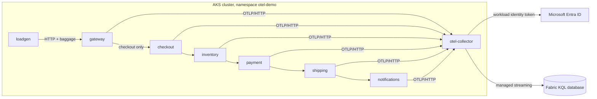

# Optional AKS workload demo

This optional extension adds a small Azure Kubernetes Service (AKS) cluster that
runs six instrumented microservices and a load generator. Unlike the manual
Container Apps job, it sends telemetry **continuously** to the same Fabric KQL
database, so dashboards stay live. It is Terraform-only and off by default
(`deploy_aks = false`).



| Component | What it does |
| --- | --- |
| `gateway`, `checkout`, `inventory`, `payment`, `shipping`, `notifications` | Six independent HTTP deployments using one Python file ([`shop.py`](../k8s/otel-demo/files/shop.py)) instrumented with the OpenTelemetry SDK. Each hop produces a server span, a log, and metric updates; payment adds a simulated `demo.postgres.query` client span. W3C trace context and baggage flow between services. No real orders, payments, or notifications are sent. |
| `loadgen` | Standard-library traffic generator ([`loadgen.py`](../k8s/otel-demo/files/loadgen.py)). Sends 1 request/s by default, half through the checkout chain and half as gateway-only browse requests, and rotates the `demo.run_id` baggage hourly. |
| `otel-collector` | OpenTelemetry Collector Contrib v0.141.0 with an [AKS variant](../k8s/otel-demo/files/collector.yaml) of the cloud configuration. It keeps the same synthetic filter and contract, stamps `k8s.cluster.name`, and keeps the `k8s.*` attributes apps set through the Kubernetes downward API. |

About 7% of requests fail (payment database query failures, service
errors, and failed browse calls) and 3% of hops have latency spikes, so error and
latency panels have signal. Failures propagate upstream: a failed payment query
also marks its payment, inventory, checkout, and gateway spans as errors and
prevents shipping and notification calls for that request.

## How it fits the existing deployment

* **Same identity, no new Fabric grant.** Terraform adds a federated identity
  credential to the existing collector managed identity. Only the Kubernetes
  service account `system:serviceaccount:otel-demo:otel-collector` on this
  cluster's OIDC issuer can exchange its token for that identity. The identity is
  already the database ingestor, and no secret is stored anywhere.
* **Same telemetry contract.** Spans, logs, and metrics use the names, attribute
  keys, and metric types that the materialized views and functions expect. AKS
  records use `deployment.environment.name = "aks"`. The Container Apps job uses
  `demo`, so filter or group by `Environment` to separate them.
* **No image build.** Pods use the public `python:3.13-slim` image. An init
  container installs hash-locked wheels from PyPI
  ([`requirements.txt`](../k8s/otel-demo/files/requirements.txt)), and the code
  is mounted from a ConfigMap.

The cluster uses the Free control-plane tier and a single Azure Linux system node
(`Standard_D2ds_v5`, ephemeral OS disk). It runs Azure CNI overlay with Cilium,
Microsoft Entra authentication with Azure RBAC (local accounts disabled), OIDC
issuer and workload identity, and automatic patch upgrades. Terraform grants the
`aks_admin_principal_id` the *Azure Kubernetes Service RBAC Cluster Admin* and
*Cluster User* roles on the cluster.

The namespace enforces the `restricted` Pod Security Standard. Every pod runs as
non-root with a read-only root filesystem, drops all capabilities, and does not
mount a Kubernetes API token. Network policies deny ingress except along the demo
call graph and from apps to the collector. Egress stays open for PyPI, Microsoft
Entra ID, and Fabric.

## Prerequisites

* A working Terraform deployment through
  [step 4 of the Terraform guide](terraform-deployment.md#4-bootstrap-fabric-and-grant-ingestion):
  Fabric bootstrapped, `kusto_cluster_uri` and `kusto_database` known, and the
  collector identity granted as database ingestor.
* The `Microsoft.ContainerService` resource provider registered, and at least
  2 vCPUs of `standardDDSv5Family` quota in the region.
* Azure CLI, `kubectl`, [kubelogin](https://azure.github.io/kubelogin/), and
  Helm. CI validates the chart with Helm v4.2.0.

## 1. Provision the cluster

Add the AKS settings to the **same** private variable file used for the rest of
the deployment. Use your own Entra object ID (or a group's) for cluster
administration:

```hcl
deploy_aks             = true
aks_admin_principal_id = "<your Entra object ID>"   # az ad signed-in-user show --query id -o tsv
# Optional: restrict the public API server to your egress ranges.
# aks_authorized_ip_ranges = ["203.0.113.0/24"]
```

```bash
terraform -chdir=infra/terraform plan -var-file=devenv.local.tfvars -out=aks.tfplan
terraform -chdir=infra/terraform show aks.tfplan
terraform -chdir=infra/terraform apply aks.tfplan
```

The plan should only **add** four resources: the cluster, two role assignments,
and the federated credential. Creation takes about five minutes.

## 2. Connect with Microsoft Entra ID

Write the credentials to a separate kubeconfig outside the repository so your
default one is unchanged, then switch it to Azure CLI token authentication:

```bash
export RESOURCE_GROUP="$(terraform -chdir=infra/terraform output -raw resource_group_name)"
export AKS_CLUSTER="$(terraform -chdir=infra/terraform output -raw aks_cluster_name)"
export KUBECONFIG="$HOME/.kube/aks-demo.config"

az aks get-credentials --resource-group "$RESOURCE_GROUP" --name "$AKS_CLUSTER" --file "$KUBECONFIG"
kubelogin convert-kubeconfig --login azurecli --kubeconfig "$KUBECONFIG"
kubectl get nodes
```

Role assignments can take a few minutes to propagate. A `Forbidden` error right
after the apply usually resolves on retry.

## 3. Install the workloads

Terraform writes the non-secret Helm values: cluster name, Kusto endpoint, and the
collector identity's client and tenant IDs. `*.local.yaml` files are git-ignored.

```bash
terraform -chdir=infra/terraform output -raw aks_helm_values > k8s/aks.local.yaml

kubectl apply -f k8s/namespace.yaml
helm upgrade --install otel-demo k8s/otel-demo \
  --namespace otel-demo --values k8s/aks.local.yaml --wait
kubectl get pods --namespace otel-demo
```

All eight pods should become `Running` within a few minutes. The chart refuses to
install into any other namespace, because the federated credential trusts only
`otel-demo`.

## 4. Verify the data

The collector log should contain no `error` entries such as `Exporting failed`
or `sending queue is full`. The load generator logs its current run ID:

```bash
kubectl logs --namespace otel-demo deploy/otel-collector --since=10m
kubectl logs --namespace otel-demo deploy/loadgen
```

Spans and metrics usually become queryable within a minute. Logs can take a few
minutes, because ingestion can fall back to queued batches. In the KQL database:

```kusto
// Spans per service from this cluster. OTELTraces uses StartTime, not Timestamp.
OTELTraces
| where StartTime > ago(15m)
| where tostring(ResourceAttributes["k8s.cluster.name"]) == "dev-aks-frti"
| summarize Spans = count(), Errors = countif(SpanStatus == "STATUS_CODE_ERROR")
    by Service = tostring(ResourceAttributes["service.name"]), SpanName

// The dashboard functions include AKS as its own environment.
RequestsOverview(30m) | where Environment == "aks"
LogsOverview(30m) | where Environment == "aks"
MetricDurationOverview(30m) | where Environment == "aks"
```

To follow one batch, read the current run ID from the `loadgen` log and filter
`TraceAttributes["demo.run_id"]` or `LogsAttributes["demo.run_id"]`.

Each signal has its own Grafana dashboard: **Fabric RTI Metrics**, **Fabric RTI
Logs**, and **Fabric RTI Traces**. Fabric has three separate dashboards with
matching names and navigation links. On **Traces**, the waterfall automatically
draws the newest complete multi-service trace. Select a TraceID in **Find a
trace** to follow a request, or paste an ID from the Logs dashboard into **Trace
ID**; clear the parameter to return to the picker. The waterfall preserves the
whole chain even when **Service** filters other panels. Automatic selection
waits at least one minute and excludes traces with missing parents to allow
ingestion to settle. A manually selected newer trace can still be partially
ingested.

Select **Environment = AKS** to focus on the continuous simulator. On
**Metrics**, **Service health**, per-service request counts, error rates, and
p95 latency show each service separately. These use server spans, excluding the
simulated database client span. Gateway rollups still count end-user requests
rather than summing every hop. Environment and service remain distinct
time-series dimensions. On **Traces**, the Grafana service map and the Fabric
**Calls by dependency** chart show the same call graph, including payment's
database dependency.

## Tuning, pausing, and cost

Change the traffic with Helm values (see [`values.yaml`](../k8s/otel-demo/values.yaml)):

```bash
helm upgrade otel-demo k8s/otel-demo --namespace otel-demo --values k8s/aks.local.yaml \
  --set loadgen.requestsPerSecond=3 --set loadgen.checkoutRatio=0.7
```

Each successful checkout produces seven spans across six services, plus six
trace-correlated logs. Browse requests produce one span and log each; failures
can shorten the checkout chain. Metrics export every 15 seconds by default.
Fabric ingestion and storage draw on the workspace capacity. Raw retention is
7 days.

| Action | Effect on cost |
| --- | --- |
| `kubectl scale --namespace otel-demo deploy/loadgen --replicas=0` | Stops new telemetry; the node keeps running. |
| `az aks stop --resource-group "$RESOURCE_GROUP" --name "$AKS_CLUSTER"` | Deallocates the node and stops compute charges. Start again with `az aks start`. |
| `deploy_aks = false`, then plan and apply | Deletes the cluster, its node resource group, role assignments, and the federated credential. The Container Apps collector is unaffected. |

The running cluster costs roughly USD 0.14 per hour (about USD 105 per month)
at westus3 pay-as-you-go list prices when this was written: the
`Standard_D2ds_v5` node, the Standard load balancer, and its outbound public IP.
The Free tier control plane and the ephemeral OS disk add no charge. Check the
[pricing calculator](https://azure.microsoft.com/pricing/calculator/) for your
region and agreement.

Managed or sandbox subscriptions can run cost automation that stops clusters on
a schedule. A stopped cluster sends no telemetry, and `kubectl` times out. Check
with `az aks show --resource-group "$RESOURCE_GROUP" --name "$AKS_CLUSTER" --query powerState.code`
and run `az aks start` when you need the demo again. Pods start again with the
cluster, and records still queued in the collector when the cluster stopped are
lost. The collector can take a few extra minutes to return, because its pod is
created only after the workload identity webhook is running; Kubernetes retries
automatically. Do not work around your organization's cost controls.

## Security notes and limitations

* **Shared ingest identity.** The Container Apps collector and the AKS collector
  use the same managed identity. Anyone who can run a pod with the
  `otel-collector` service account in `otel-demo` can write to the database. For
  production, give each cluster its own identity and ingestor grant, and limit who
  can create pods in that namespace.
* **Public API server.** The control plane is reachable from the internet but
  requires Entra authentication. Set `aks_authorized_ip_ranges` to restrict it,
  or use a private cluster for production.
* **Not production monitoring.** There is no Container Insights, Defender for
  Containers, or Azure Policy add-on, and a single node gives no high
  availability. Add them for real workloads.
* **Public dependencies at startup.** Pods pull images from Docker Hub and wheels
  from PyPI on every start. Hash checking protects against tampering, not
  against registry outages. Mirror both, or build an image, for anything long
  lived.
* **Synthetic data only.** The collector filter accepts only resources marked
  `demo.synthetic=true`. Read [data handling](security-and-operations.md#data-handling)
  and [introduce a workload](extending.md#introduce-a-workload) before pointing
  real services at it.
* **Bicep parity.** The Bicep deployment has no AKS equivalent.

## Updating dependencies

The init container installs only wheels whose sha256 hashes appear in
[`requirements.txt`](../k8s/otel-demo/files/requirements.txt). To update the
OpenTelemetry packages, regenerate the lock with the command in its header, then
remove any non-sha256 `--hash` lines that the index returns. Keep the target
Python version and platform in line with `images.python`. Run the tests and a
`helm upgrade`, then confirm that the init container still succeeds.

## Troubleshooting

| Symptom | Likely cause |
| --- | --- |
| `kubectl` reports `dial tcp ... i/o timeout` | The cluster is stopped (check `powerState`), or `aks_authorized_ip_ranges` excludes your address. |
| Collector logs `AADSTS70021: No matching federated identity record found` | The pod is not in `otel-demo` or not using the `otel-collector` service account, or the cluster was recreated and the credential has a stale issuer. Re-apply Terraform. |
| Collector logs `403` or `Forbidden` from Kusto | The collector identity is not a database ingestor. Re-run the ingestor grant from the Terraform guide. |
| `install-dependencies` init container fails | The node cannot reach PyPI, or the lock file does not match the image's Python version or platform. |
| Collector logs `sending queue is full` | Exports are slower than incoming data. Check for Kusto throttling or errors, or reduce `loadgen.requestsPerSecond`. |
| No rows from AKS in KQL | Check the time column (`StartTime` for traces), the cluster-name filter, and the collector logs. |
