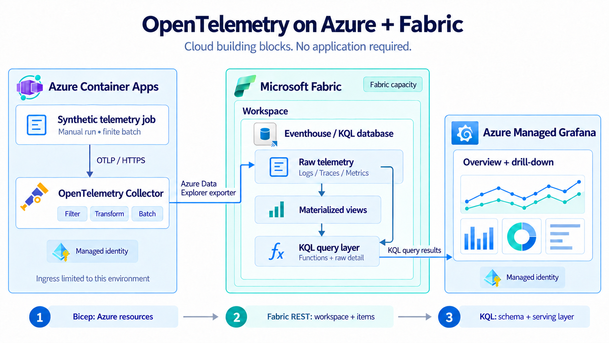
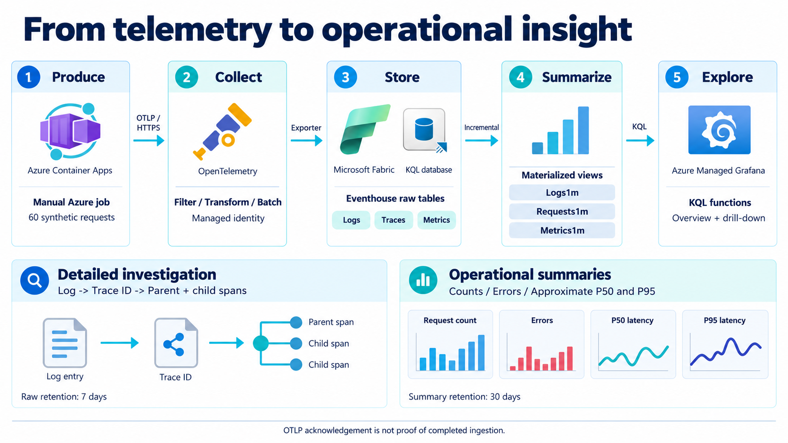

# Architecture and data flow

The sample separates collecting telemetry, storing and summarizing it, and
presenting it. Each boundary has a small interface: OTLP/HTTP into the collector,
the Azure Data Explorer exporter into Eventhouse, and KQL query results into
Grafana.

## Components

| Component | Responsibility |
| --- | --- |
| Synthetic Container Apps job | One producer fabricates four correlated service contexts and related logs/metrics. It has no access to Fabric. |
| Container Apps collector | Receives OTLP on port 4318 behind an environment-internal ingress, filters demo signals, transforms attributes, batches records, and exports them. |
| Collector user-assigned managed identity | Authenticates to Fabric as a database ingestor. No client secret is supplied to the cloud collector. |
| Fabric capacity | Supplies compute for the workspace. Reuse an eligible active capacity or explicitly create one. |
| Eventhouse / KQL database | Stores typed raw telemetry and incrementally maintained materialized views. |
| KQL serving functions | Expose time-bounded summaries with stable column names for dashboards. |
| Managed Grafana | Queries the Fabric query endpoint using its own read-only identity. |
| Log Analytics | Stores Container Apps platform and collector console diagnostics so the telemetry pipeline can itself be investigated. Application OTLP records go to Fabric. |

The Container Apps environment is a managed public-network environment with an
**internal application ingress**. Other applications in the same environment can
reach the collector. This is not a claim of VNet isolation or private connectivity
to Fabric. The job uses HTTPS at the ingress; the ingress forwards to the OTLP
receiver inside the environment.

## One event through the system

1. The job creates a synthetic request across gateway, checkout, payment, and
   postgres contexts. It records four related spans, a log, and metric samples.
   Selected requests simulate failures. A run ID identifies the batch in trace/log
   detail and is excluded from metric dimensions.
2. The collector accepts only the demo signal contract. Resource and record
   attributes are restricted, log bodies are replaced, span events are dropped,
   and batches limit export overhead. These are sample controls for synthetic
   data, not a general-purpose sensitive-data classifier.
3. The exporter authenticates with the collector identity and sends the three
   signal types into typed tables. Managed streaming can fall back to queued
   ingestion, introducing delay; receiving
   an OTLP success response does not prove that the rows are queryable yet.
4. Eventhouse maintains minute-level materialized summaries. Trace identifiers
   stay in detail tables instead of becoming metric dimensions.
5. Grafana calls the serving functions for summaries and queries the raw tables
   for logs and trace detail. A view query includes its unmaterialized delta;
   materialization lag and ingestion lag are different things.

## Deployment surfaces

| Surface | Defined here | Why it is separate |
| --- | --- | --- |
| Azure Resource Manager | Bicep: identity, optional capacity, Grafana, collector environment, job, and platform diagnostics. | These are Azure resources. |
| Fabric service API | Python bootstrap: workspace, Eventhouse, KQL database, and Grafana workspace Viewer grant. | These are Fabric service objects with Fabric permissions. |
| Kusto data plane | KQL: tables, mappings, policies, materialized views, functions, and database ingestor grants. | These define data storage, query behavior, and data access. |

Creating Azure resources does not grant access to Fabric data. A capacity ARM
resource ID is also different from the Fabric capacity UUID used to assign a
workspace. The deployment guide makes both distinctions explicit.

## Design choices

The collector runs as one warm replica for a predictable demonstration. The
producer is a manual job so no background traffic runs after the demonstration.
The baseline uses managed streaming with queued fallback, short raw retention, and compact rollups.
It leaves application instrumentation, continuous generation, alert routing,
high availability, and private network integration as deliberate extensions.

An observability outage should not control application authorization or
transactional state. When adding a workload, preserve that separation and define
the acceptable telemetry loss and recovery behavior.

For a retained broker handoff, see the separate
[Event Hubs and Eventstream option](buffered-architecture.md). Its Bicep broker
foundation is available; the complete buffered ingestion and projection profile
requires additional implementation. The primary deployment stays direct.

See the [editable Mermaid sources](diagrams/) and the
[Microsoft Fabric Eventhouse overview](https://learn.microsoft.com/en-us/fabric/real-time-intelligence/eventhouse).
