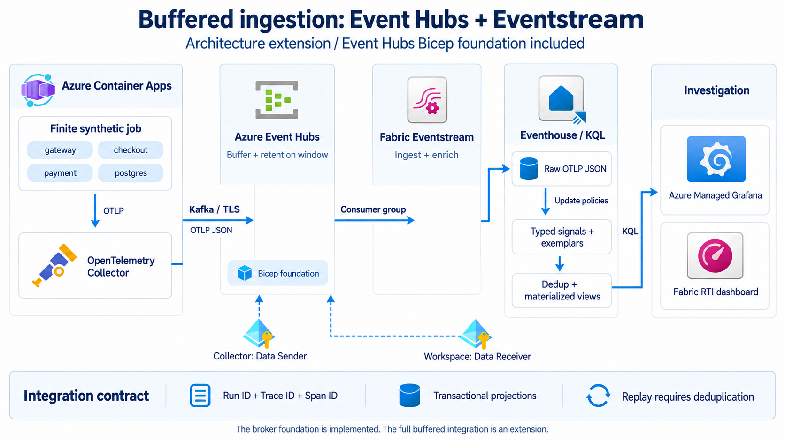

# Optional buffered architecture

A broker can separate telemetry production from its processing in Fabric. This
profile adds a durable handoff through Azure Event Hubs, followed by a raw landing
table and explicit transformations. It is useful when independent consumers,
bounded replay or ingestion bursts justify the extra infrastructure and operating
work.

The repository's primary deployment uses the direct collector-to-Eventhouse
exporter. The buffered profile is an architectural extension. A standalone Bicep
template provides its Azure broker foundation; the remaining integration is
described below and is not implemented or verified end to end.



## What is available

| Building block | Repository status |
| --- | --- |
| Azure synthetic producer with four correlated services | Implemented in the primary sample. The current 60-request job produces 240 spans, 60 logs and 120 metric points. |
| Collector directly exporting to Eventhouse; typed `OTEL*` tables; minute materialized views; Grafana | Implemented in the primary sample, with offline validation. Cloud acceptance remains a deployment step. |
| Event Hubs Standard namespace, hub, consumer group and managed identity role assignments | Provided by [`infra/optional/event-hubs.bicep`](../infra/optional/event-hubs.bicep); compiled offline. Not deployed by `infra/main.bicep`. |
| Collector Kafka exporter sending OTLP JSON with managed identity | Design target. No Kafka exporter configuration is supplied or activated. |
| Fabric workspace identity, Event Hubs connection and Eventstream | Design target requiring separate Fabric setup. Not created by the primary bootstrap or the optional Bicep template. |
| `CollectorRaw` bronze table and transactional update policies | Design target. No table, parsing functions or policies for this profile are supplied. |
| Replay-safe deduplication and metric exemplars | Design target. The primary sample does not implement these capabilities. |
| Native Fabric Real-Time Dashboard | Optional presentation target. No dashboard item or native dashboard definition is provisioned. |

Deploying the broker alone does not send telemetry through it, create Fabric
items or change the primary sample's exporter.

## When the broker fits

Use this profile when producers and Fabric processing must recover independently,
multiple consumers need their own progress, or an explicitly sized retention
window is needed to reprocess accepted broker messages. Event Hubs retention is a
bounded recovery window, not a permanent archive. Data still in a collector's
memory queue has not reached that window.

The template starts with one Standard throughput unit, two partitions and one day
of retention. These values make the building block small and explainable. They
are not a universal sizing recommendation or a 24-hour recovery guarantee:
throughput, event size, partition-key distribution, consumer lag, retention,
regional availability and the permitted recovery time must be measured together.
Auto-inflate and Capture are not enabled by this template.

## Target data contract

### Preserve the OTLP envelope

The collector would serialize signal batches as **OTLP JSON** and publish them
over the Event Hubs Kafka endpoint using TLS and Entra OAuth authentication. The
Kafka topic corresponds to the event hub. A Kafka JSON message is not the flat
row format produced by the primary sample's Azure Data Explorer exporter.

OTLP JSON keeps nested `resourceSpans`, `resourceLogs` or `resourceMetrics`, with
resource attributes, instrumentation scopes and record arrays. A single broker
message can contain many spans, logs or data points. If all three signals share
one topic, define an unambiguous signal discriminator and schema version in the
envelope or message metadata. Preserve trace IDs, span IDs and the producer's
stable record identifiers across retries and replay.

The primary collector image is pinned to version `0.141.0`. A Kafka and managed
identity implementation must select a compatible collector release, verify its
Kafka exporter encoding and Azure authentication extension, and test token
refresh in Container Apps. A broker role assignment does not configure those
components. Consult the [upstream Kafka exporter](https://github.com/open-telemetry/opentelemetry-collector-contrib/tree/main/exporter/kafkaexporter)
and the [Azure Event Hubs Kafka authentication documentation](https://learn.microsoft.com/en-us/azure/event-hubs/azure-event-hubs-apache-kafka-overview).

### Land raw messages before typing them

The proposed Fabric Eventstream reads the `fabric` consumer group through a
connection authenticated by the **Fabric workspace identity**. Its destination
would be a `CollectorRaw` table in Eventhouse, with the original message in a
dynamic payload and explicit ingestion metadata. Retain transport coordinates
where available and the original stable record IDs, so operators can distinguish
a replayed record from a legitimate second observation.

Confirm how the selected Eventstream source and JSON format preserve nested
arrays and metadata before defining an ingestion mapping. Mapping a nested OTLP
envelope directly to the existing flat `OTELLogs`, `OTELTraces` or `OTELMetrics`
schema would not flatten it correctly. See [Event Hubs sources with workspace
identity](https://learn.microsoft.com/en-us/fabric/real-time-hub/add-source-azure-event-hubs).

### Transform into typed records

Parsing functions and table update policies would expand resource, scope and
record arrays into typed trace, log, metric and exemplar tables. Transformation
must preserve the resource context on every expanded record, convert timestamps
and numeric values correctly, and route unknown schema versions explicitly.

Transactional update policies can make a source ingestion fail when a dependent
transformation fails. This is a consistency choice, not exactly-once delivery or
an automatic quarantine mechanism. Test malformed messages, unexpected arrays,
schema changes and target-column mismatches. Define how rejected messages are
identified and retried without blocking healthy traffic indefinitely. Monitor
consumer lag and Kusto ingestion failures. See [Kusto update policy behavior](https://learn.microsoft.com/en-us/kusto/management/update-policy?view=microsoft-fabric).

Keep a useful raw retention period if investigation or reparsing is required.
Removing raw payloads immediately would remove that investigation surface; broker
retention and raw-table retention address different recovery steps.

### Deduplicate before counting and link exemplars

Broker checkpoints, producer retries and ingestion retries can lead to duplicate
delivery. Define identity before deriving totals. A trace span can use its trace
and span IDs; logs need an explicit record identifier because several legitimate
logs can share a trace and span. Metric point identity must account for service,
metric, dimensions, timestamp and aggregation temporality. A new broker offset
after republishing does not by itself identify the original logical record.

The design should expose deduplicated detail and minute summaries whose counts
remain correct after a deliberate replay. Validate the legal materialized-view
query plan and its cost; arbitrary materialized-view stacking cannot be assumed
to work. Preserve metric semantics: a scalar gauge, a delta counter and a
cumulative counter require different interpretations.

An exemplar associates a metric observation with trace/span context. A future
exemplar table and dashboard link could make that association navigable. The
current producer sends gauge measurements and correlated trace/log records, but
does not emit exemplars. See [OpenTelemetry exemplars](https://opentelemetry.io/docs/specs/otel/metrics/data-model/#exemplars).

### Serve either dashboard surface

KQL serving functions can expose the deduplicated and aggregated contracts to
Grafana or a native Fabric Real-Time Dashboard. The native dashboard is an
optional Fabric item, separate from the Eventhouse and Eventstream. Its data
source, permissions, queries and drill-through navigation require their own
definition and acceptance checks. See [Real-Time Dashboards](https://learn.microsoft.com/en-us/fabric/real-time-intelligence/dashboard-real-time-create).

## Identity boundaries

| Principal | Primary direct profile | Optional buffered profile |
| --- | --- | --- |
| Collector managed identity | Database ingestor in the demo KQL database. | Event Hubs **Data Sender**, scoped to the one hub. Required for a Kafka exporter implementation. |
| Fabric workspace identity | Not required for the primary direct exporter. | Event Hubs **Data Receiver**, scoped to the one hub; used by the Fabric connection. |
| Grafana system-assigned identity | Viewer on the dedicated Fabric workspace. | Still a read-only query identity if using Grafana. It does not send or consume broker messages. |
| Deployment/database administrator | Provisions resources, schema and explicit grants. | Also manages the Fabric connection, Eventstream topology and update-policy definitions. |

Azure role assignments use **principal object IDs**. The primary KQL `aadapp`
grant and collector identity selector use an **application/client ID**. Supplying
the correct UUID type is required even though both have the same textual form.
See [Event Hubs data roles and scope](https://learn.microsoft.com/en-us/azure/event-hubs/authorize-access-azure-active-directory).

## Deploy only the broker foundation

First complete the identity foundation from the
[primary deployment guide](deployment.md). In Fabric **Workspace settings >
Workspace identity**, create or enable the intended workspace identity and obtain
its principal object ID. The primary bootstrap does not create it. Use a
dedicated workspace and verify that the identity belongs to the intended tenant.

Create `infra/optional/event-hubs.local.bicepparam` with:

```bicep
using './event-hubs.bicep'

param collectorPrincipalId = '<collector managed identity object UUID>'
param fabricWorkspaceIdentityPrincipalId = '<Fabric workspace identity object UUID>'
```

The collector object ID is the foundation deployment's
`collectorIdentityPrincipalId` output. Do not use `collectorIdentityClientId`
here. The private parameter file is ignored by Git. The deploying identity needs
permission to create the Event Hubs resources and their scoped role assignments;
the subscription's `Microsoft.EventHub` provider must be registered.

From the repository root, compile and inspect the proposed deployment:

```bash
mkdir -p output
az bicep build --file infra/optional/event-hubs.bicep \
  --outfile output/event-hubs.json

az deployment group what-if \
  --resource-group "$RESOURCE_GROUP" \
  --parameters infra/optional/event-hubs.local.bicepparam
```

The following command creates the **billable broker resources and role grants
only**:

```bash
az deployment group create \
  --name fabric-rti-buffer-foundation \
  --resource-group "$RESOURCE_GROUP" \
  --parameters infra/optional/event-hubs.local.bicepparam
```

The template provides a Standard namespace with one throughput unit, minimum TLS
1.2, local/SAS authentication disabled, one two-partition hub with one-day
retention, and a `fabric` consumer group. Its outputs contain resource names,
resource IDs and endpoints, including the Kafka bootstrap server on port 9093;
they contain no shared keys or connection-string secrets. The namespace has
public network access protected by Entra authorization. This template does not
establish private networking or zone redundancy.

Do not change the primary exporter merely because the broker exists. Complete
and test the Kafka exporter, Fabric connection, Eventstream, raw schema and
transformations as a separate implementation. Event Hubs namespace charges can
apply even before any telemetry is sent. Remove only the optional resources and
their grants when retiring this foundation; preserve the primary demo and any
other resources in a shared group.

## Acceptance for a future buffered implementation

Use an isolated test run and retain evidence for each boundary: the collector
publishes with managed identity; Event Hubs accepts messages; Eventstream consumes
the intended consumer group; raw envelopes remain intact; typed rows preserve
correlation; rollups match the deduplicated detail; and the selected dashboard
shows those results. Then interrupt a consumer, resume it, and deliberately replay
a known range to measure recovery and prove that counts do not inflate. Test
identity failures and malformed records independently. These checks have not
been run for this optional profile.
