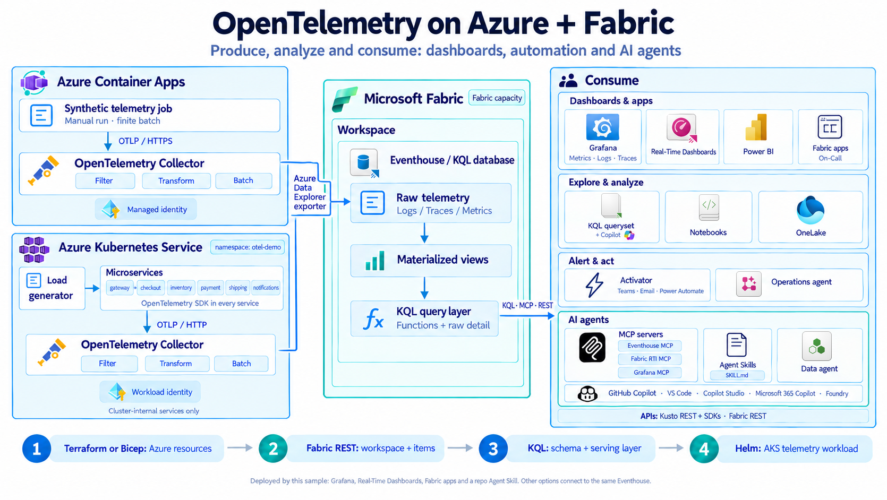

# Consume the telemetry: dashboards, automation, and AI agents

Every consumer reads the same Fabric Eventhouse KQL database: the raw
`OTELLogs`, `OTELTraces`, and `OTELMetrics` tables, the one-minute materialized
views, and the serving functions described in
[KQL and materialized views](kql-and-materialized-views.md). Adding a consumer
does not change the ingestion path.



## At a glance

"In this sample" says whether the repository deploys the option, ships a file
for it, or leaves it to you.

| Group | Option | How it reads the data | In this sample |
| --- | --- | --- | --- |
| Dashboards and apps | Azure Managed Grafana | Azure Data Explorer data source with the Grafana managed identity | Deployed: Metrics, Logs, and Traces dashboards |
| Dashboards and apps | Fabric Real-Time Dashboards | KQL database data source inside the workspace | Deployed: Metrics, Logs, and Traces dashboards |
| Dashboards and apps | Power BI | KQL database connector, DirectQuery or import | Optional |
| Dashboards and apps | Fabric apps | Read-only KQL through the shared telemetry layer | Optional extension: [mock and on-call apps](mock-apps.md) |
| Explore and analyze | KQL queryset with Copilot | KQL editor; Copilot turns questions into KQL | Optional |
| Explore and analyze | Notebooks | Kusto Spark connector or Python Kusto client | Optional |
| Explore and analyze | OneLake | OneLake availability exposes tables as Delta | Optional |
| Alert and act | Activator | Rules on KQL results; Teams, email, or Power Automate | Optional; compared in the on-call app |
| Alert and act | Operations agent | Watches KQL data against goals and recommends actions | Optional (preview) |
| AI agents | Eventhouse remote MCP server | Microsoft-hosted MCP endpoint per KQL database | Optional; verified with this sample |
| AI agents | Fabric RTI MCP server | Local open-source MCP server (`uvx`) | Optional |
| AI agents | Azure Managed Grafana MCP server | Built into the Grafana instance | Available on the deployed Grafana; verified |
| AI agents | Agent Skills | `SKILL.md` instructions that agents load on demand | Included: [`otel-eventhouse-investigation`](../.github/skills/otel-eventhouse-investigation/SKILL.md) |
| AI agents | Fabric data agent | Natural-language Q&A over the KQL database | Optional |
| Developers | Kusto REST API and SDKs | `POST <query-uri>/v1/rest/query` with an Entra token | Used by [`apps/telemetry/kusto.mjs`](../apps/telemetry/kusto.mjs) |
| Developers | Fabric REST API | Workspace and item management | Used by [`scripts/bootstrap-fabric.py`](../scripts/bootstrap-fabric.py) |

AI clients that can use the MCP servers, skills, or data agent include GitHub
Copilot (CLI, VS Code, and the cloud agent), Copilot Studio, Microsoft 365
Copilot, and Microsoft Foundry agents.

## MCP servers

MCP servers run tools, and Agent Skills explain how to use them. Each server
acts with the permissions of the identity that calls it.

### Eventhouse remote MCP server (preview)

A Microsoft-hosted HTTP endpoint for one KQL database. Nothing to install.

1. Open the KQL database `observability` in Fabric. On **Overview**, select
   **Copy URI** next to **MCP Server URI**. The URI has this shape:
   `https://api.fabric.microsoft.com/v1/mcp/dataPlane/workspaces/<workspace-id>/items/<kql-database-id>/kqlEndpoint`
2. Add it to your client. In VS Code, `.vscode/mcp.json`:

   ```json
   {
     "servers": {
       "eventhouse": {
         "type": "http",
         "url": "https://api.fabric.microsoft.com/v1/mcp/dataPlane/workspaces/<workspace-id>/items/<kql-database-id>/kqlEndpoint"
       }
     }
   }
   ```

   In GitHub Copilot CLI, run `/mcp add`, choose **HTTP**, and paste the URI.
3. Sign in with an account that can read the database.

Tools: `getSchema`, `executeQuery`, `getGeneralKQLExamples`, and
`getSpecificKQLExamples`. Schema and example tools need Copilot in Fabric to be
enabled for the tenant. To check the endpoint from a terminal:

```bash
TOKEN=$(az account get-access-token --resource https://api.fabric.microsoft.com --query accessToken -o tsv)
curl -s "$EVENTHOUSE_MCP_URL" \
  -H "Authorization: Bearer $TOKEN" \
  -H "Content-Type: application/json" \
  -H "Accept: application/json, text/event-stream" \
  -d '{"jsonrpc":"2.0","id":1,"method":"tools/list"}'
```

See [Get started with the remote MCP server for eventhouses](https://learn.microsoft.com/en-us/fabric/real-time-intelligence/mcp-remote-eventhouse).

### Fabric RTI MCP server (local)

The open-source [microsoft/fabric-rti-mcp](https://github.com/microsoft/fabric-rti-mcp)
server runs on your machine with `uvx` and signs in with Azure Identity (for
example `az login`). Besides Kusto query tools it has Eventstream and Activator
tools.

```json
{
  "servers": {
    "fabric-rti": {
      "command": "uvx",
      "args": ["microsoft-fabric-rti-mcp"],
      "env": {
        "KUSTO_SERVICE_URI": "<eventhouse-query-uri>",
        "KUSTO_SERVICE_DEFAULT_DB": "observability"
      }
    }
  }
}
```

The query URI is on the Eventhouse **Overview** page. The server's
`kusto_command` tool can run management commands, so use an identity with only
the Viewer role on the database when exploring. See
[Fabric RTI MCP servers](https://learn.microsoft.com/en-us/fabric/real-time-intelligence/mcp-overview).

### Azure Managed Grafana MCP server

Every Azure Managed Grafana instance, including the one this sample deploys,
serves an MCP endpoint at `https://<grafana-endpoint>/api/azure-mcp`.

```json
{
  "servers": {
    "grafana": {
      "type": "http",
      "url": "https://<grafana-endpoint>/api/azure-mcp"
    }
  }
}
```

VS Code signs you in with Entra ID. Other clients can send a bearer token from
`az account get-access-token --resource https://dashboard.azure.com` or a
Grafana service account token. Useful tools include `amgmcp_dashboard_search`,
`amgmcp_dashboard_inspect`, `amgmcp_kusto_get_metadata`, `amgmcp_kusto_query`,
and `amgmcp_alert_list`.

Kusto queries through this server use the Grafana data source and therefore the
Grafana managed identity. Grafana roles decide who can use it, and
`amgmcp_dashboard_update` needs the Editor role. See
[Azure Managed Grafana MCP server](https://learn.microsoft.com/en-us/azure/managed-grafana/grafana-mcp-server).

## Agent Skills

A skill is a folder with a `SKILL.md` file that an agent loads when a task
matches its description. GitHub Copilot reads project skills from
`.github/skills/`; see [About agent skills](https://docs.github.com/en/copilot/concepts/agents/about-agent-skills).

- **This repository** ships
  [`otel-eventhouse-investigation`](../.github/skills/otel-eventhouse-investigation/SKILL.md).
  It describes the tables, views, and functions, the service call chain, an
  investigation workflow, and seven tested KQL recipes. Open the repository in
  a skill-aware client, connect one of the MCP servers above, and ask, for
  example, "Which service is failing most in the last 15 minutes, and show me a
  slow trace."
- **Skills for Fabric** ([microsoft/skills-for-fabric](https://github.com/microsoft/skills-for-fabric))
  adds general Fabric skills, including `eventhouse-cli`. In Copilot CLI:

  ```text
  /plugin marketplace add microsoft/skills-for-fabric
  /plugin install fabric-skills@fabric-collection
  ```

## Fabric data agent

A data agent answers natural-language questions over the KQL database for
people who do not write KQL. Create it in the workspace, add the
`observability` KQL database as a source, and give it instructions such as
"Use `RequestsOverview` for latency; join logs to traces on `TraceID`." The
queries in [`fabric/queries.kql`](../fabric/queries.kql) make good examples.
Published agents can be used from Microsoft 365 Copilot, Copilot Studio, and
Microsoft Foundry. See
[Fabric data agent concepts](https://learn.microsoft.com/en-us/fabric/data-science/concept-data-agent)
and [Create a data agent](https://learn.microsoft.com/en-us/fabric/data-science/how-to-create-data-agent).

## Other options

- **Power BI**: connect to the KQL database and call the serving functions,
  for example `RequestsOverview(24h)`. See
  [Power BI data connector](https://learn.microsoft.com/en-us/fabric/real-time-intelligence/power-bi-data-connector).
- **KQL queryset and Copilot**: write or generate KQL in the Fabric editor.
  See [Copilot for writing KQL queries](https://learn.microsoft.com/en-us/fabric/fundamentals/copilot-for-writing-queries).
- **Notebooks**: query from Spark or Python. See
  [Use notebooks with Eventhouse](https://learn.microsoft.com/en-us/fabric/real-time-intelligence/notebooks).
- **OneLake**: turn on OneLake availability to expose tables as Delta for
  Spark, SQL, and Power BI. See
  [Eventhouse OneLake availability](https://learn.microsoft.com/en-us/fabric/real-time-intelligence/event-house-onelake-availability).
- **Activator**: set an alert from a dashboard tile or a KQL query, for
  example on `ErrorCount` from `RequestsOverview(5m)`, and send it to Teams,
  email, or Power Automate. See
  [What is Activator](https://learn.microsoft.com/en-us/fabric/real-time-intelligence/data-activator/activator-introduction).
  The on-call app in [mock apps](mock-apps.md) maps Datadog On-Call features
  to Activator and other Fabric components.
- **Operations agent** (preview): watches KQL data against business goals and
  recommends actions. See
  [Operations agent](https://learn.microsoft.com/en-us/fabric/real-time-intelligence/operations-agent).
- **Kusto REST API and SDKs**: see the
  [Kusto REST API](https://learn.microsoft.com/en-us/kusto/api/rest/?view=microsoft-fabric).

## Access and security

- Give people and agents the Viewer role on the KQL database. Ingestion
  identities do not need query access, and consumers do not need ingestor
  rights.
- The remote MCP endpoints are public Microsoft endpoints. They require Entra
  ID sign-in and the caller's own permissions; they do not open a network path
  to the collectors.
- A local MCP server runs with your signed-in identity. Do not grant it
  administrator rights for exploration.
- Keep workspace IDs, item IDs, and tokens out of committed MCP configuration.
  Use placeholders as shown above, or client-side inputs.
