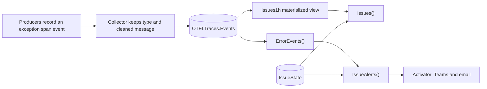

# Issues, triage state, and issue alerts

Thresholds answer "is the error rate high?". An error tracker answers a different
question: "which distinct failures are happening, which are new, and which came
back after we fixed them?". This sample adds that view on top of the same
Eventhouse tables. It borrows the *ideas* of open-source error trackers such as
[Rustrak](https://github.com/rustrak/rustrak); the implementation is written
from scratch in KQL against OpenTelemetry conventions.



## 1. Exceptions reach Fabric, cleaned

Failing spans carry one OpenTelemetry `exception` span event with
`exception.type` and `exception.message`. The AKS services raise typed errors per
hop (for example `QueryCanceledError` on the database call and
`DownstreamServiceError` upstream of a failure); the synthetic job does the same
for its failing requests without changing its published counts.

The collector keeps only `exception` events, only those two attributes, and
replaces UUIDs, email addresses, IPv4 addresses, long hex strings, and numbers in
the message with placeholders such as `<uuid>` and `<n>`. See
[data handling](security-and-operations.md#data-handling) for what this does and
does not protect.

## 2. Grouping into issues

| Object | What it returns |
| --- | --- |
| `NormalizeErrorMessage(message)` | The message with variable values replaced, again, for producers that bypass the collector rules. |
| `ErrorEvents(lookback)` | One row per failed span: `Fingerprint`, service, environment, version, span name, exception type, normalized message, trace and span IDs. |
| `Issues1h` | Materialized view: events, first and last seen, and one example trace per issue, hour, environment, and version. |
| `Issues(lookback)` | One row per issue and environment: title, culprit, status, events, first seen (ever), last seen, the version it was introduced in, versions affected, example trace, and a 24-hour hourly trend. |

The **fingerprint** is the first 16 hex characters of a SHA-256 hash of
service, span name, exception type, and normalized message. It is deterministic,
so an issue keeps its identity across deployments, environments, and versions.
A failed span without an exception event still groups, as `SpanError:
<span name> failed`.

```kusto
Issues(24h)
| where Environment == "aks"
| project Fingerprint, Status, Events, Title, Culprit, IntroducedIn, LastSeen
| order by Events desc
```

Like the other views, `Issues1h` is created without backfill: it counts spans
ingested after it exists. `ErrorEvents()` reads the raw table and covers the full
7-day raw retention.

## 3. Triage state

`IssueState` is an append-only table; the newest row per fingerprint wins, and
`IssueStatus()` returns it. Change state with the script, which signs in through
Azure CLI and records who made the change from the authenticated principal:

```bash
python3 scripts/issue-state.py list --lookback 24h
python3 scripts/issue-state.py resolve <fingerprint> --in-version 1.3.0 --note "retry added"
python3 scripts/issue-state.py mute <fingerprint> --for 12h
python3 scripts/issue-state.py reopen <fingerprint>
```

The caller needs write access to the database (database user or admin; see
[`fabric/permissions.kql`](../fabric/permissions.kql)). The script validates
every value and base64-encodes the free-text note, so nothing a user types is
spliced into the management command.

## 4. Issue alerts

`IssueAlerts(lookback)` raises three triggers, each **once per transition**:

| Alert | Fires when |
| --- | --- |
| `new_issue` | The fingerprint is seen for the first time inside the window. |
| `regression` | The first event after the issue was resolved falls inside the window. With `--in-version`, only events from that version or later count, so old pods still draining do not raise it. |
| `unmute` | A mute expired inside the window and the issue occurred after the expiry. |

Muted issues raise nothing until the mute expires. Reopen a regressed issue (or
resolve it again after the next fix) to arm it for the next transition.

### Send them to Teams or email with Activator

The RTI On-Call package exports a ready Activator item: a KQL source that runs
`IssueAlerts()` every five minutes and one rule per action that fires on every
returned row.

```bash
node apps/oncall/scripts/export-issue-alerts.ts \
  --teams oncall@contoso.com --email sre@contoso.com \
  > output/issue-alerts.local.json
# Then run the printed `az rest` command to create the item.
```

Rules are imported **stopped** unless you pass `--start`; start them in Activator
once the recipients are right. Without recipients the rule gets a placeholder
Teams address and stays stopped. Fabric accepting the item proves the definition
is valid, not that a message was delivered: start the rule, trigger a new issue
(for example by raising the AKS failure rate, see
[release health](release-health.md)), and confirm the message arrives.

Alerts are evaluated against ingested data. A span ingested after the
five-minute window it belongs to was already evaluated can miss its alert;
check the Issues dashboard for anything that matters.
