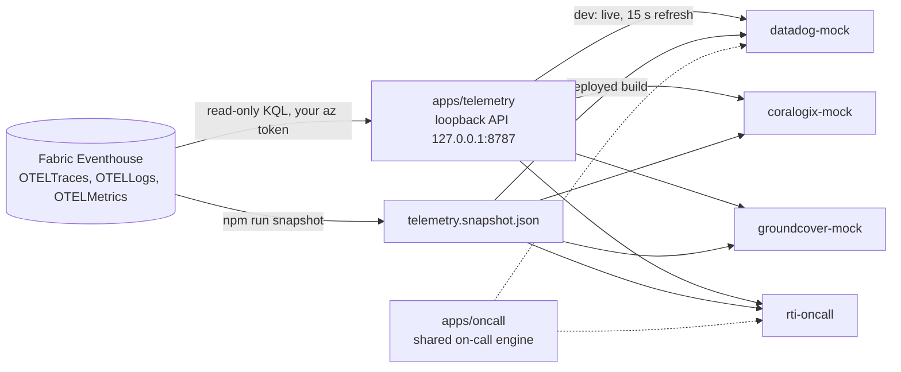

# Mock observability apps on Rayfin

This optional extension adds three small web apps that imitate the look and
workflow of Datadog, Coralogix, and groundcover, backed by the telemetry that
the AKS demo already stores in the Fabric Eventhouse. They are built as
Rayfin (the Microsoft Fabric Apps SDK and CLI) projects, so each one can be
deployed to the Fabric workspace as a static app item.

A fourth app, `rti-oncall`, is the Fabric Real-Time Intelligence side of an
on-call comparison: the Datadog mock has a Datadog On-Call section and
`rti-oncall` shows the same pages, schedules, and escalations built with Fabric
components. See [On-Call: Datadog and Fabric RTI side by side](#on-call-datadog-and-fabric-rti-side-by-side).

> **Unofficial demo mocks.** They are original code written to resemble the
> public web interfaces of those products and are not affiliated with or
> endorsed by Datadog, Inc., Coralogix Ltd., or groundcover Inc. No vendor logo,
> image, or source code is included. Each app shows a disclaimer.



## Layout

| Path | Purpose |
| --- | --- |
| [`apps/telemetry/`](../apps/telemetry/) | Shared data layer: a read-only Kusto client, the KQL that reads spans, logs, and metrics, a pure bundle builder (services, dependency edges, traces, joined logs, metric series), a loopback API, a snapshot exporter, and the typed client (`useTelemetry`, query parser, formatters) that all four apps import as `@telemetry`. |
| [`apps/datadog-mock/`](../apps/datadog-mock/) | Log Explorer, APM service catalog and service pages, service map, trace flame graph and waterfall, Metrics Explorer, a dashboard, Monitors, and On-Call (pages, teams, schedules, escalation policies, analytics, and settings). |
| [`apps/oncall/`](../apps/oncall/) | Shared, deterministic on-call engine imported as `@oncall`: seeded teams, schedules, routing rules, escalation policies, and monitors; pages derived from seven days of real service health; viewer actions; analytics; the Datadog and Fabric capability matrix; and cross-links between the two apps. |
| [`apps/rti-oncall/`](../apps/rti-oncall/) | On-call management for Fabric Real-Time Intelligence: the same pages and schedules expressed as Activator rules, Eventhouse tables, and Power Automate paging flows, plus a capability matrix and a side-by-side page comparison. |
| [`apps/coralogix-mock/`](../apps/coralogix-mock/) | Dark APM service catalog with derived SLO and health, service drill-down, service map, Explore Logs, Explore Tracing, plus local-only alert definitions for metrics, logs, traces and simulated email/Teams/PagerDuty destinations. |
| [`apps/groundcover-mock/`](../apps/groundcover-mock/) | Workloads, map, Logs, Traces, Metrics, and Dashboards in the light groundcover layout. |

Each app has `rayfin/rayfin.yml` (static hosting from `packages/frontend`) and a
Vite, React, and TypeScript frontend with hand-written SVG charts. One hoisted
install in `apps/` serves all four frontends. RTI On-Call also uses the Rayfin
client/Fabric authentication SDK and a separately installed Functions package
for persistent alert authoring.

## What is real and what is derived

* **Real:** service names, request counts, error rates, latency percentiles,
  dependency edges, traces and spans, logs, and the two metrics
  (`demo.requests`, `demo.request.duration`).
* **Derived deterministically from those numbers:** Apdex (T = 500 ms), SLO and
  health status, monitor and issue badges.
* **Not available, so not invented:** CPU and memory, hosts beyond the AKS node,
  users, and log messages. The collector deliberately keeps telemetry minimal,
  so every log body is `Synthetic request completed` and the apps show the
  attributes that do exist (service, pod, node, version, scenario, outcome,
  trace and span IDs). Navigation entries that the real products have but this
  data cannot back are visible and show a "Not part of this mock" toast.

## Run locally

Requirements: Node.js 24 or later, Azure CLI signed in to an account that can
read the KQL database, and the AKS demo running so that data is flowing.

```bash
cd apps
npm ci
npm ci --ignore-scripts --prefix rti-oncall/packages/functions
npm test                      # telemetry, on-call engine and alerting tests
npm run api                   # read-only API on http://127.0.0.1:8787
npm run dev:datadog           # http://localhost:5181
npm run dev:coralogix         # http://localhost:5182
npm run dev:groundcover       # http://localhost:5183
npm run dev:rti-oncall        # http://localhost:5184
```

The API reads `KUSTO_CLUSTER_URI` and `KUSTO_DATABASE`, or the
`queryServiceUri` and `databaseName` fields of `output/fabric.local.json` that
the bootstrap script writes. In dev the apps poll it every 15 seconds and fall
back to the bundled snapshot when it is not running.

The Coralogix mock's **Alerts > Alert Definitions** page saves rules in the
browser and evaluates their current signal against the telemetry window. Email,
Microsoft Teams and PagerDuty are simulated notification destinations only;
this mock does not deliver messages or manage on-call schedules. Coralogix's
documented PagerDuty connector routes alerts to PagerDuty, where schedules and
escalations are managed.

## Deploy to Fabric with Rayfin

The deployed visualization pages read a point-in-time snapshot containing only
synthetic demo telemetry. RTI On-Call's authenticated alert backend separately
creates live Activator KQL sources; alert execution does not depend on refreshing
that snapshot.

```bash
cd apps
npm run snapshot -- 60                      # last 60 minutes (plus 7 days of service health) into each app's public/ folder
npm run build                               # typecheck and build all four
export RAYFIN_TELEMETRY_OPTOUT=1            # optional
cd datadog-mock
npx @microsoft/rayfin-cli login --tenant <tenant-id>      # interactive sign-in
npx @microsoft/rayfin-cli up -n --workspace-id <workspace-id>   # dry run
npx @microsoft/rayfin-cli up --workspace-id <workspace-id>
```

Repeat the last two commands in `coralogix-mock`, `groundcover-mock`, and
`rti-oncall`. Use the signed-in user identity; do not create a service principal
or secret for this.
Static assets are deployed with `assetAccess: protected`, so the apps are
private. Each item gets a generated hosting URL of the form
`https://<generated-name>.webapp.fabricapps.net`. It is not derived from the item
name: a guessed host such as `datadog-mock-<region>.webapp.fabricapps.net`
returns `404 The requested application could not be found`. `rayfin up` prints
the real one as `hostingUrl` (and a Fabric portal link as `fabricDeepLink`) and
records both, with the item ID, in `rayfin/.deployments.json` (git-ignored):

```bash
grep '"hostingUrl"' */rayfin/.deployments.json     # run from apps/
```

Opening that URL in a browser shows a Fabric "Sign in to continue" page. Allow
popups, select **Sign in**, and sign in with an account that can open the
workspace. Requests without a browser session, such as `curl`, get
`401 Authentication required`. Re-run `npm run snapshot` and `rayfin up` to
refresh the data.

A snapshot keeps every log line in its window but only a sample of traces (the
newest, every error, and the slowest), so older minutes of the trace histograms
lean towards errors; the apps say so next to the chart. The live API keeps the
newest 2,500 logs plus up to 600 error logs, so in dev mode the log histogram
over a long window overstates errors in its older minutes.

## On-Call: Datadog and Fabric RTI side by side

The Datadog mock has a Datadog On-Call section modelled on the public
[Datadog On-Call documentation](https://docs.datadoghq.com/service_management/on-call/):
monitors page a team through its `@oncall-<team>` handle, ordered routing rules
pick an escalation policy and urgency (with support hours), the policy notifies
schedule, user, or team targets step by step until someone acknowledges, and
responders acknowledge, reassign, snooze, comment, declare an incident, or
resolve. Schedules have layers, restrictions, and overrides; analytics report
MTTA, MTTR, escalations, and responder load.

`rti-oncall` applies the same methodology with Fabric Real-Time Intelligence:

| Datadog On-Call | Fabric RTI equivalent in `rti-oncall` |
| --- | --- |
| Monitor with warning and alert thresholds | KQL over `OTELTraces` and an Activator rule with two conditions |
| Missing data | Activator heartbeat rule |
| Team, handle, and routing rules | Team roster and routing table in Eventhouse, evaluated by the paging flow |
| Escalation policy | Power Automate flow with notify, wait for acknowledgment, and repeat steps |
| Push, SMS, voice, and email | Teams and Outlook through Activator and Power Automate; SMS and voice through Azure Communication Services |
| Acknowledge from Slack or the mobile app | Teams adaptive card buttons that write the acknowledgment back to Eventhouse |
| Schedules and overrides | Shift and override tables in Eventhouse, maintained by the app, with ICS export |
| On-Call Analytics | KQL over the page events and a Real-Time Dashboard |

Both apps render one deterministic model from [`apps/oncall/`](../apps/oncall/),
so page numbers, responders, and timestamps match. The model is built from the
seven days of five-minute service health in the snapshot: each monitor
evaluates real error rates and latency, and the nightly AKS stop shows up as
missing-data pages. Two seeded manual pages are always open, one escalating
and one acknowledged, so a demo always has live work. Teams, people, schedules,
and responder behaviour are fictional and simulated. Actions you take in either
app (acknowledge, reassign, snooze, comment, page) are stored in that browser
only and can be reset from the app.

Routes are aligned, and each view links to its counterpart in the other app:

| Datadog mock | `rti-oncall` |
| --- | --- |
| `#/on-call` | `#/` |
| `#/on-call/pages[/<id>]` | `#/pages[/<id>]` |
| `#/on-call/teams[/<id>]` | `#/teams[/<id>]` |
| `#/on-call/schedules[/<id>]` | `#/schedules[/<id>]` |
| `#/on-call/escalation-policies[/<id>]` | `#/escalations[/<id>]` |
| `#/on-call/analytics` | `#/analytics` |
| `#/on-call/settings` | `#/settings` |
| `#/monitors[/<id>]` | `#/rules[/<id>]` |
| (no counterpart) | `#/rules/new`, `#/rules/<id>/edit` |

`rti-oncall` also has `#/compare`, a 27-row capability matrix, and
`#/compare/<page-id>`, which lays out one page's lifecycle in Datadog terms next
to the Fabric components that perform each step. Each row carries one of four
labels: **Native in Fabric** (6), **Activator + Power Automate** (9), **Built on
Fabric data** (9), or **Gap** (3). The gaps are declaring an incident (hand off
to an ITSM tool instead), a dedicated on-call mobile app (Teams mobile
notifications instead), and cross-organisation paging.

The comparison's schedules, paging and escalation flow are a design demonstration.
It does not create Power Automate flows or on-call Eventhouse tables. Alert
authoring is different: the rule builder now creates real Activator items and
native Teams/email actions directly from the web UI.

### Alert rules built in the app

Open `#/rules/new`, select **Sign in to Fabric**, and use the Fabric SSO popup.
Choose error rate, p95 latency, request rate or missing data, a service, an
evaluation window, warning/alert thresholds, and native Teams or email actions.
Recipients must be real addresses; demo `.example` addresses are rejected.
**Save stopped in Fabric** persists without activating notifications.
**Save and start in Fabric** enables the rules and can send real notifications.
No CLI command or manual action attachment is needed.

The authenticated `alertRules` function in
[`packages/functions`](../apps/rti-oncall/packages/functions/) calls the Fabric
REST API using a platform-issued Fabric token. It creates a scheduled KQL
source on the workspace's `observability` database and one native rule per
threshold/action. The editable configuration is stored in the Activator
definition, not browser storage. Save completes only after a definition
read-back. The list reloads persisted alerts, and edit, start/stop and delete
operate on the same live items. Stale revisions are rejected; retrying a create
does not create another copy.

**Open in Activator** leads to execution history and delivery errors. The
historical preview uses the bundled snapshot, not delivery telemetry. Live
alerts are not replayed through the demo page engine and continue running when
the browser closes. Request-rate drop rules emit zero-value buckets even when
all service data is absent. The p95 preview is a request-weighted approximation of
five-minute percentiles; it is not the exact percentile over the entire window.
**Suggest from data** remains a historical threshold aid, not a guarantee of
future notification frequency.

Native actions here are Teams and email only. Power Automate paging, SMS,
rotations and escalation remain simulated comparison features, not hidden
manual deployment steps. Legacy browser-only rules remain labeled **Local
demo**; **Publish to Fabric** opens them in the builder with the unsupported
paging action removed and requires real notification recipients. Resetting
demo rules in Settings never deletes live alerts.

For deployment, `services.functions` must be enabled with `auth.type:
application`; the checked-in Rayfin configuration supplies this. Run the normal
full `rayfin up` so authentication settings and function code are both applied.
The Fabric app owner needs Contributor access to the workspace and read access
to the Eventhouse. Browser users need Execute access to this app and authenticate
through Fabric SSO. Azure CLI tokens without `Item.Execute.All` cannot be used
for Rayfin's external token exchange; this does not replace browser SSO.

The hosted URLs in [`apps/oncall/src/links.ts`](../apps/oncall/src/links.ts)
drive the cross-links. After the first `rayfin up` of each app, put its
`hostingUrl` there, add the `rti-oncall` URL to `allowedRedirectUris` in
`apps/rti-oncall/rayfin/rayfin.yml`, then build and deploy both apps again.

## Security notes

* The API binds to `127.0.0.1`, accepts only `GET`, sends `request_readonly`
  KQL, and uses your existing `az` sign-in. It stores and exposes no secret.
* The snapshot and the apps contain only the synthetic telemetry that the demo
  already generates.
* The alert function uses the app owner's external-resource permissions. Share
  app Execute access only with trusted on-call operators: they can manage the
  app's shared alerts and recipients. The function accepts structured rules,
  not arbitrary KQL, URLs or item definitions, confines operations to its own
  workspace, and will not edit/delete items without its app-specific marker.
  Fabric resource tokens remain server-side.
* The AKS cluster is stopped by a tenant policy at night, so take the snapshot
  while the cluster is running if you want fresh data.
